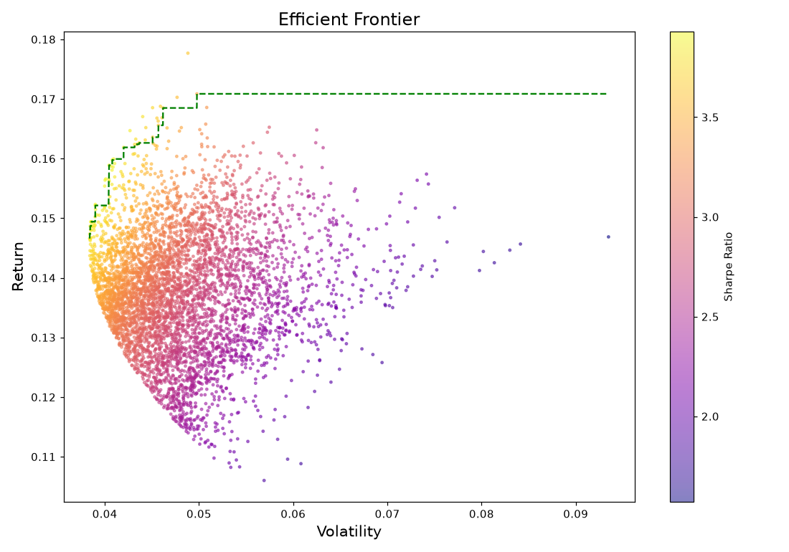
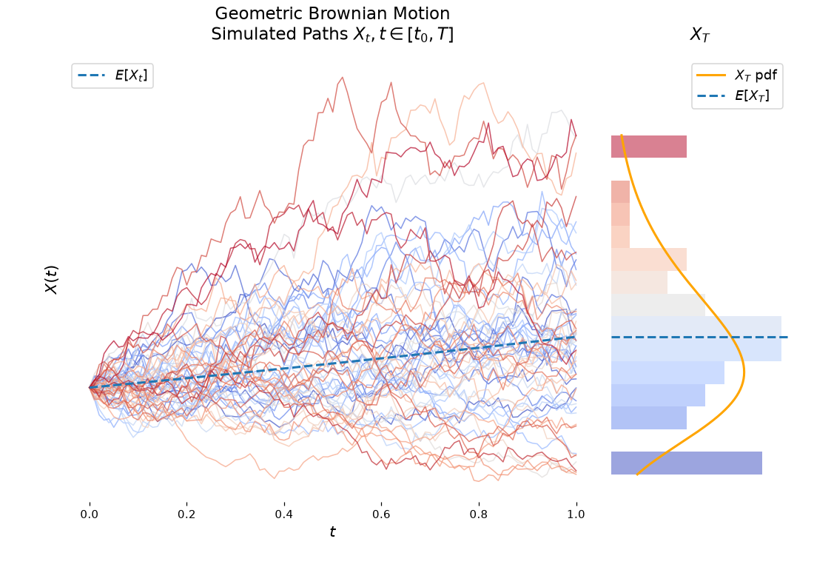
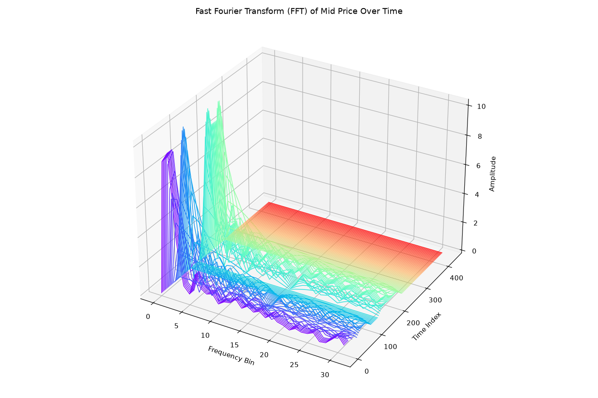

# Portfolio Efficient Frontier: Markowitz frontier, GBM paths and a limit order book simulator in Python

[](LICENSE)


**Portfolio Efficient Frontier is a small open-source Python toolkit for quantitative finance experiments.** It plots the Markowitz Efficient Frontier for randomly generated portfolios, simulates Geometric Brownian Motion (GBM) price paths, and includes a limit order book simulator with Poisson order arrivals whose mid price is analysed with a 3D rolling FFT plot. It is meant for learning and visual exploration, **not for managing real money**.



---

## Contents

- [What it does](#what-it-does)
- [Screenshots](#screenshots)
- [Proof that it runs](#proof-that-it-runs)
- [Quick start](#quick-start)
- [Project layout](#project-layout)
- [Tests](#tests)
- [Honest status](#honest-status)
- [Learn more](#learn-more)
- [FAQ](#faq)
- [License](#license)

---

## What it does

- **Efficient Frontier** (`orderbook.py`, `plot_efficient_frontier`): generates 5,000 random portfolios over 4 assets and plots the risk/return trade-off, coloured by Sharpe ratio, with the frontier curve traced in green.
- **GBM simulation** (`orderbook.py`, `plot_gbm_paths`; `gbm_demo.py`): simulates random price paths as used to model stock prices, with a side histogram and the theoretical log-normal terminal PDF overlaid.
- **Limit order book simulator** (`orderbook.py`, `simulator.py`, `utils.py`): limit and market orders arrive as independent Poisson processes and are matched FIFO at each price level, producing a mid-price series, best bid/ask, spread, volume imbalance and a full trade history.
- **3D rolling FFT view** (`main.py`): runs the simulator for 500 steps and plots a rolling Fast Fourier Transform of the mid price, showing how its frequency content evolves over time.

## Screenshots

### Efficient Frontier: 5,000 random portfolios, coloured by Sharpe ratio


### Geometric Brownian Motion: simulated paths with terminal distribution



### 3D rolling FFT of the simulated order book's mid price



*All three are real output from this code, run headlessly with matplotlib's Agg backend and the project's default parameters and random seed.*

---

## Proof that it runs

Everything below was run on **Python 3.11.15, Windows 11**, in a fresh virtual environment built from `requirements.txt`. `pip check` reported no broken requirements.

```text
$ python -m pytest tests/ -q
..........................                                               [100%]
26 passed in ~3s
```

All four entry points were then run headlessly (`matplotlib.use('Agg')`) and their figures saved to PNG — the screenshots above. One real bug was found and fixed in the process:

- **The 3D FFT plot was visually broken.** Mid prices sit near 100, so the FFT's DC component (bin 0) came out roughly **640× larger** than every other frequency bin (≈6,500 vs. a max of ≈10). On the plot's shared linear scale this squashed every bin that actually carries price-fluctuation information down to a flat wall at zero — the chart looked like two blank panels. Fixed in `main.py` by demeaning each window before the FFT, which is standard practice and is exactly what a "rolling FFT of price fluctuations" should show. The before/after numbers and the fix are covered by `tests/test_plots.py::test_fft_window_demeaning_removes_dc_component`.

---

## Quick start

**Verified on Python 3.11 on Windows.** No pinned minimum versions are required beyond those in `requirements.txt`; other recent Python 3 environments should work but were not independently tested.

```bash
git clone https://github.com/maahin-1/Portfolio-Efficient-Frontier.git
cd Portfolio-Efficient-Frontier

python -m venv .venv
# Windows:  .venv\Scripts\activate      macOS/Linux:  source .venv/bin/activate
pip install -r requirements.txt

python orderbook.py   # Efficient Frontier plot (switch to the GBM plot by editing the script)
python main.py        # order book simulation and the 3D rolling FFT of the mid price
python gbm_demo.py    # standalone GBM path demo
```

Each script opens an interactive matplotlib window (`plt.show()`). To save a figure to a file instead, without a display, use the Agg backend:

```bash
python -c "
import matplotlib; matplotlib.use('Agg')
import matplotlib.pyplot as plt
import orderbook; orderbook.plot_efficient_frontier()
plt.savefig('frontier.png')
"
```

## Project layout

```text
orderbook.py   Efficient Frontier and GBM plots; Order and OrderBook matching-engine classes
simulator.py   event loop driving Poisson order arrivals into the OrderBook
utils.py       Poisson arrival and random trader-action helpers
main.py        runs the simulator and draws the 3D rolling FFT of the mid price
gbm_demo.py    standalone GBM path demo
tests/         26 unit tests covering the matching engine, simulator and plots
```

## Tests

```bash
pip install -r requirements.txt pytest
python -m pytest tests/ -q
```

The suite is offline and runs headlessly (matplotlib's Agg backend, set in `tests/conftest.py`), so it needs no display and no network access. It covers the order book matching engine directly: FIFO ordering within a price level, partial fills, sweeping multiple price levels, spread/mid-price/volume-imbalance calculations, and trade-history export — none of which had any test coverage before.

---

## Honest status

- **Educational and visual, not a trading system.** The order book simulator uses independent Poisson arrivals and random trader behaviour; it does not model real market microstructure, adverse selection or latency.
- **The Efficient Frontier uses fixed, made-up returns and a fixed covariance matrix** for 4 hypothetical assets (not real tickers), purely to illustrate the Markowitz construction.
- **GBM paths are synthetic**, with a chosen drift and volatility; they are not fitted to or validated against real price data.
- **Verified on one setup:** Python 3.11 on Windows.

---

## Learn more

- [Geometric Brownian Motion](https://en.wikipedia.org/wiki/Geometric_Brownian_motion)
- [Markowitz Efficient Frontier](https://en.wikipedia.org/wiki/Efficient_frontier)
- [Modern Portfolio Theory](https://en.wikipedia.org/wiki/Modern_portfolio_theory)

## FAQ

### What is the Efficient Frontier?
The set of portfolios that offer the highest expected return for each level of risk, from Markowitz's Modern Portfolio Theory. This project plots it for 5,000 randomly weighted combinations of 4 hypothetical assets.

### What is Geometric Brownian Motion used for?
It is the standard simple model for random stock price paths, where returns are log-normally distributed. `gbm_demo.py` and `orderbook.plot_gbm_paths` both simulate and visualise it.

### What does the limit order book simulator do?
`simulator.py` drives `orderbook.py`'s matching engine with Poisson-arriving limit and market orders from `utils.py`, producing a realistic-looking (but synthetic) mid-price series, spread, volume imbalance and full trade history.

### What does the 3D FFT plot show?
How the frequency content of the simulated mid price changes over a rolling 64-step window as the simulation progresses, with the DC (constant-price) component removed so the actual fluctuations are visible.

### Does it use real market data?
No. The frontier uses fixed example returns, and the GBM and order book simulations are entirely synthetic.

### Is this investment advice?
No. It is an educational project.

## License

MIT. See [LICENSE](LICENSE).

*Keywords: Markowitz Efficient Frontier, Modern Portfolio Theory, Geometric Brownian Motion, limit order book simulation, market microstructure, Poisson order arrivals, Fast Fourier Transform, quantitative finance, Python, open source.*
